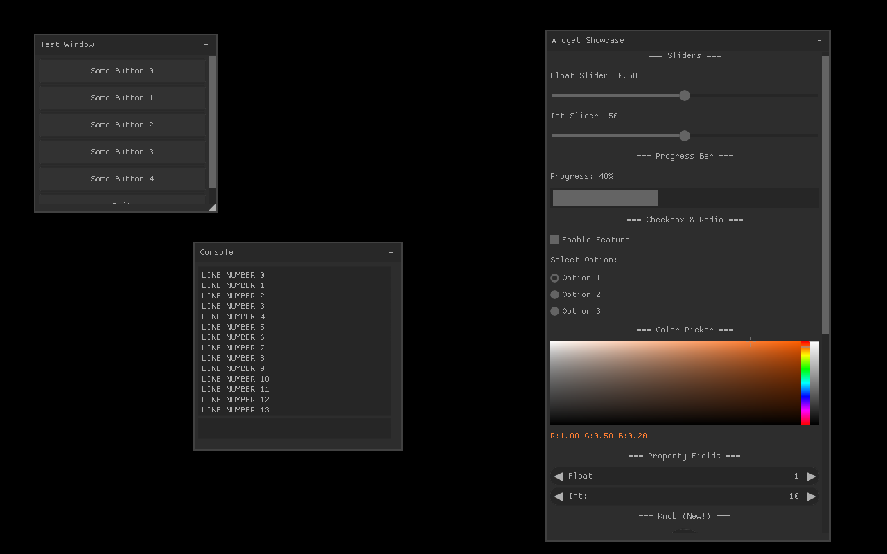

# NuklearDotNet

NuklearDotNet is an unsafe C# binding and renderer abstraction for [Nuklear](https://github.com/Immediate-Mode-UI/Nuklear), a small immediate-mode GUI library written in C. The current binding uses the newer `Nuklear2.dll` native project and provides both direct P/Invoke access and a higher-level frame API.

The primary development path targets .NET 9 on Windows. The repository also retains .NET Framework 4.8 projects as a legacy compatibility path.

## Release 1.1.0

The Windows x64 release publishes the optimized native `Nuklear2.dll` and the .NET 9 managed `NuklearDotNet.dll` from the same validated commit. Download both assets from the [1.1.0 GitHub release](https://github.com/sbarisic/NuklearDotNet/releases/tag/1.1.0) and place them together beside your executable. Do not mix either file with a DLL from an older release or another architecture.

The modern binding assembly is now consistently named `NuklearDotNet.dll`, matching its namespace, product name, legacy assembly, and historical release asset.

> [!NOTE]
> The managed binding validates critical sizes, offsets, enum values, and native exports before initialization. A mismatched or stale `Nuklear2.dll` fails fast with a detailed `BadImageFormatException`; see [ABI validation](INFO.md#abi-validation).



## Project status

- Native library: Nuklear2, built as `Nuklear2.dll`
- Primary managed target: .NET 9
- Platform: Windows; examples are configured primarily for x64
- API layers: raw unsafe `Nuklear` bindings and the convenience-oriented `NuklearAPI`
- Current release: 1.1.0 (`NuklearDotNet.dll` assembly version 1.1.0.0)
- Included renderer examples: Raylib, SFML.Net, MonoGame DesktopGL, and Windows Forms
- Packaging: source projects and native DLLs; no NuGet package is currently published
- Testing: a native ABI/export validation executable is included; no CI workflow is currently configured

For architecture, maintenance procedures, and verified project details, see [INFO.md](INFO.md). Planned work and active defects are tracked in [TODO.md](TODO.md).

All four modern renderer examples run the same .NET port of Nuklear's native `demo/common` showcase. A launcher opens with Overview enabled and can show Calculator, Canvas, Node Editor, and the Style Configurator; it also exposes all ten bundled themes. The native file-browser demo is not included.

## Prerequisites

- Windows
- Git with submodule support
- .NET 9 SDK
- Visual Studio/MSBuild with the Desktop development with C++ workload and a Windows SDK
- The `v145` C++ platform toolset currently selected by both native projects, or an intentional local retarget to an installed toolset

The native projects are `.vcxproj` files. The `dotnet` CLI by itself cannot build the complete solution; use Visual Studio or its full MSBuild installation for the native build.

## Clone and build

Clone both Nuklear source submodules with the repository:

```powershell
git clone --recurse-submodules https://github.com/sbarisic/NuklearDotNet.git
cd NuklearDotNet
```

If the repository was cloned without submodules:

```powershell
git submodule update --init --recursive
```

Open `NuklearDotNetDotnet.sln` in Visual Studio, select `Debug` and `x64`, and build the solution. This builds the native libraries before the managed binding and examples. The active binding loads `Nuklear2.dll`; a Debug native build places it in `bin_dbg` and the example projects copy it beside their managed output.

The equivalent command from a Visual Studio Developer PowerShell is:

```powershell
msbuild NuklearDotNetDotnet.sln /m /p:Configuration=Debug /p:Platform=x64
```

After a successful solution build, run the Raylib example from Visual Studio or with:

```powershell
dotnet run --project Example_Raylib/Example_RaylibDotnet.csproj --configuration Debug --no-build
```

The SFML.Net example uses the same native-first build order and can then be run with:

```powershell
dotnet run --project Example_SFML/Example_SFMLDotnet.csproj --configuration Debug --no-build
```

The MonoGame and Windows Forms examples follow the same pattern:

```powershell
dotnet run --project Example_MonoGame/Example_MonoGameDotnet.csproj --configuration Debug --no-build
dotnet run --project Example_WindowsForms/Example_WindowsFormsDotnet.csproj --configuration Debug --no-build
```

Validate the DLL and managed binding without opening a GUI:

```powershell
dotnet run --project BindingValidation/BindingValidation.csproj --configuration Debug --no-build
```

If MSBuild reports `MSB8020`, install the configured `v145` toolset or explicitly retarget both native projects to a compatible installed toolset. A command such as `dotnet build NuklearDotNetDotnet.sln` is not a substitute because the .NET SDK MSBuild does not provide the C++ targets required by the native projects.

## Included examples

| Project | Backend | Managed target | Notes |
| --- | --- | --- | --- |
| `Example_Raylib` | Raylib-cs 6.1.1 | `net9.0` | Primary example; manually verified with indexed triangles, font-atlas texturing, clipping, input, and a cached render texture. |
| `Example_SFML` | SFML.Net 2.5.1 | `net9.0` | Framebuffered indexed-triangle backend with font-atlas texturing, clipping, full input, clipboard, resize, and shutdown handling. |
| `Example_MonoGame` | MonoGame DesktopGL 3.8.1.303 | `net9.0-windows` | Direct indexed-triangle GPU backend with clipped rendering, full input, SDL clipboard, resize, and shutdown handling. |
| `Example_WindowsForms` | Windows Forms/System.Drawing | `net9.0-windows` | Cached CPU triangle rasterizer with textured/color-interpolated output, full input, clipboard, resize, and shutdown handling. |

These projects are implementation examples rather than a compatibility guarantee. Their managed projects compile as of the verification recorded in [INFO.md](INFO.md#verification-snapshot); the Raylib example was also interactively verified on Windows x64.

The shared showcase is implemented by `ExampleShared.CommonDemoSuite`. Backends create one suite after their graphics device, call `Frame(deltaSeconds)` from the render loop, and call `Shutdown()` before destroying the window or graphics context.

## API overview

`Nuklear` is the low-level layer. It exposes native functions and structs through unsafe P/Invoke declarations, closely following the C API.

`NuklearAPI` owns the current context, queues input, builds a frame, converts Nuklear commands to vertices and indices, and dispatches draw commands to a `NuklearDevice` implementation.

See [NUKLEAR_API.md](NUKLEAR_API.md) for the complete application guide, renderer-backend contract, API reference, and troubleshooting notes.

### Implementing a renderer

Use `NuklearDeviceTex<T>` when the backend has its own texture type. It converts Nuklear integer handles to backend texture objects for you:

```csharp
sealed class Device : NuklearDeviceTex<Texture>
{
    public override bool EnableFrameBuffered => false;

    public override Texture CreateTexture(int width, int height, IntPtr data)
    {
        // Upload the RGBA32 font-atlas pixels and return a backend texture.
        throw new NotImplementedException();
    }

    public override void SetBuffer(NkVertex[] vertices, ushort[] indices)
    {
        // Upload or retain the converted vertex and index data.
    }

    public override void Render(
        NkHandle userdata,
        Texture texture,
        NkRect clipRect,
        uint offset,
        uint count)
    {
        // Apply clipRect, bind texture, and draw count indices from offset.
    }
}
```

Alternatively, derive from `NuklearDevice` and manage integer texture handles directly. Backends may also override `Init`, `FontStash`, `BeginRender`, and `EndRender`.

Framebuffer caching is opt-in: `NuklearDevice.EnableFrameBuffered` defaults to `false`. For cached rendering, override it to return `true` and implement `IFrameBuffered`:

```csharp
interface IFrameBuffered
{
    void BeginBuffering();
    void EndBuffering();
    void RenderFinal();
}
```

`BeginBuffering` and `EndBuffering` surround the GUI redraw. `RenderFinal` composites the cached result every frame. Framebuffer devices redraw when input or an explicit `QueueForceUpdate` invalidation is queued.

Forward backend input through the device event queue:

```csharp
device.OnMouseButton(NuklearEvent.MouseButton.Left, x, y, isDown);
device.OnMouseMove(x, y);
device.OnScroll(scrollX, scrollY);
device.OnText(text);
device.OnKey(NkKeys.Enter, isDown);
```

### Building a frame

Initialize one device, then submit immediate-mode UI from the render loop:

```csharp
NuklearAPI.Init(device);

while (running)
{
    NuklearAPI.SetDeltaTime(deltaSeconds);

    NuklearAPI.Frame(() =>
    {
        NuklearAPI.Window(
            "Test Window",
            100, 100, 300, 200,
            NkPanelFlags.BorderTitle | NkPanelFlags.MovableScalable,
            () =>
            {
                NuklearAPI.LayoutRowDynamic(35);

                if (NuklearAPI.ButtonLabel("Some Button"))
                    Console.WriteLine("Button pressed");
            });
    });
}
```

The library currently owns a single static context. Calling `NuklearAPI.Init` more than once throws, and multiple-context support remains planned work.

Call `NuklearAPI.Shutdown()` before destroying the renderer or window. Shutdown is idempotent, frees native allocations, and invokes the device's optional `Shutdown` hook.

## Legacy .NET Framework projects

`NuklearDotNet.sln` and the non-`Dotnet` project files target .NET Framework 4.8. They remain in the repository for compatibility, but new development and documentation use `NuklearDotNetDotnet.sln` and the .NET 9 projects.

## Updating and contributing

The native source trees are Git submodules and are not intended to be edited as part of normal binding updates. Updating Nuklear2 may require changes to the native compilation unit, exported symbol list, P/Invoke declarations, and managed struct layouts; follow the checklist in [INFO.md](INFO.md#updating-nuklear2).

Contributions are welcome. Please account for the unsafe native boundary, build the relevant managed projects, and test the affected renderer manually. Keep active work and newly discovered defects synchronized with [TODO.md](TODO.md).

NuklearSharp was the original inspiration for this binding: [leafi/NuklearSharp](https://github.com/leafi/NuklearSharp). NuklearDotNet is also used by the author's [libTech](https://github.com/sbarisic/libTech) engine project.

## License

NuklearDotNet is dual-licensed under the [MIT License or The Unlicense](LICENSE), at your choice. The Nuklear submodules and third-party dependencies retain their own licenses.
